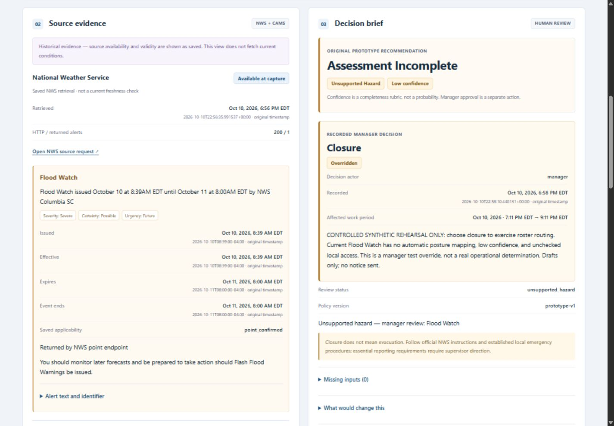

# Operations dashboard design candidate

Candidate application source: `8f6923ac528204ab83c3e095e9768f8188985172` on `design/operations-dashboard`. Status: **READY FOR USER REVIEW / NOT DEPLOYED**.

The existing manager desk now leads with facility identity, affected work period, evidence collection and the human decision. Source evidence and the original prototype recommendation sit beside each other on desktop; a recorded approval or override has its own panel. Draft routing, manual follow-up and historical replay remain explicit. This is a presentation pass over the existing FastAPI/static-JS application.

Only `app/static/index.html`, `app/static/styles.css` and `app/static/app.js` changed relative to base `c3d9c5673847c62a2ee824c6bf52230fc0f628d7`. Python, API request bodies, Strands tools, rule mappings, dependencies, database schema, audit storage and authorization are unchanged in this pass. The base already contains the earlier **undeployed** feedback candidate `656e8a0`; review the combined candidate before any deployment. A frontend-only diff against the base does not imply a frontend-only release against production.

## Before and after

Both comparisons show the same frozen historical decision `16a170c1-af9b-4950-86b2-a3eecf1ad26b`, collected October 10, 2026 at 22:56 UTC. Its saved Flood Watch is historical evidence. The synthetic site's retained name mentions a Flash Flood Warning; the actual saved alert is displayed as **Flood Watch**, with unsupported hazard / low confidence and a controlled manager test override. Neither image is a new LIVE weather evaluation.

| Viewport requested | Before | After |
| --- | --- | --- |
| Desktop, 1440 × 1000 | [Original desk](evidence/design/before-desktop.jpg) | [Candidate desk](evidence/design/after-desktop.jpg) |
| Narrow, 390 × 844 | [Original narrow desk](evidence/design/before-narrow.jpg) | [Candidate narrow desk](evidence/design/after-narrow.jpg) |
| Full desktop page | [Before](evidence/design/before-desktop-full.jpg) | [After](evidence/design/after-desktop-full.jpg) |
| Full narrow page | [Before](evidence/design/before-narrow-full.jpg) | [After](evidence/design/after-narrow-full.jpg) |

The browser returns JPEG frames. Their measured encoded sizes are recorded separately in [capture metadata](evidence/design/capture-metadata.json); viewport settings and image pixel dimensions are not assumed identical.

Additional views: [manager timing form](evidence/design/after-manager-timing.jpg), [essential-personnel draft](evidence/design/after-essential-draft.jpg), [narrow draft](evidence/design/after-drafts-narrow.jpg), [loading](evidence/design/after-loading-desktop.jpg), [sign-in timeout](evidence/design/after-login-error-narrow.jpg), [synthetic missing source](evidence/design/after-missing-source-desktop.jpg).

## What changed

- Compact navy header, clear section numbers, restrained white cards, consistent spacing and native system typography. The operational context replaces the oversized marketing headline as the main visual priority.
- Responsive work-period inputs, two-column source/brief layout and three-column recipient cards on desktop; stacked sections and recipient cards on narrow screens. All recipients remain visible.
- Text-backed status colors: blue for source/ready context, amber for review/low confidence/override, teal for approval, red for unavailable/error/reject, plum for drafts/replay. Status meaning does not depend on color alone.
- Sources separate retrieval time from alert validity and model valid time. Exact stored timestamps remain visible below local facility time. Empty feed and unavailable feed have distinct explanations. AQ identifies its modeled grid origin and stored units.
- Confidence is labeled a completeness rubric, not a probability. The original recommendation remains separate from manager posture, actor, time, reason and confirmed timing.
- Draft cards retain stored messages, channels and routing reasons; essential personnel and deferred manual follow-up are prominent. No delivery or scheduling feature was added.
- Evaluate, manager save, login, history refresh and explorer buttons have readable busy/disabled states. Keyboard focus and native disclosures remain usable; animation respects reduced-motion preference.
- One demonstrated usability fix: an invalid Basic-auth request remained pending in the in-app browser. The initial read-only sign-in/config request now has a 15-second timeout and restores retry with a safe message. Server authentication, business POST requests, idempotency and agent deadlines are unchanged.

## Checks actually performed

All new browser decisions used a separate ignored SQLite database at loopback `8084`. New evaluations are clearly labeled **SYNTHETIC DESIGN TEST**, with source/model calls disabled. The unchanged manager endpoints and decision service still enforce their existing validation. Two actual historical exports were imported with exact bundle/snapshot hashes.

| Check | Result and evidence |
| --- | --- |
| Full existing Windows suite on final static source | **VERIFIED**: 89 passed in 12.43s; [final log](evidence/design/windows-tests-final.txt). Earlier executions also passed; they are separate observations. |
| JavaScript syntax / dependency consistency | **VERIFIED**: `node --check app/static/app.js`; `python -m pip check` reported no broken requirements. [Verification record](evidence/design/verification.json). |
| Sign-in error, timeout, retry | **VERIFIED** in isolated preview; [browser checks](evidence/design/browser-checks.json) and timeout screenshot. |
| Invalid work period / reasonless override / missing timing | **VERIFIED**: existing API returned 422 / 422 / 409 respectively; visible errors and restored retry buttons. [Access-log excerpt](evidence/design/browser-server.txt). |
| Evaluate → review → approve → outbox → replay | **VERIFIED**, synthetic evidence through existing authenticated decision endpoint. |
| Normal recommendation → reasoned closure override | **VERIFIED**; original normal recommendation remains distinct from stored closure. |
| Delayed arrival with confirmed time and basis | **VERIFIED**; initial missing-timing error, successful retry and stored timing displayed in replay. |
| Reasoned rejection / variable counts | **VERIFIED**; actual rejection package shows 0 included / 12 excluded / 0 deferred. Approved/override cases show their actual 9 / 2 / 1 counts. |
| Reload / double-click / Refresh | **VERIFIED** for acknowledged active evaluation, decision double-clicks and history refresh. Each decided run has exactly one decision and one outbox package; one additional test evaluation remains unreviewed. Refresh before a POST acknowledgement is not guaranteed by this check. |
| All 12 recipient routes / essential / telework / offsite / no shift | **VERIFIED** in rendered frozen and synthetic packages; channel, reason, unsent status and manual follow-up visible. |
| Original historical data after new browser writes | **VERIFIED**: two original exports, bundle hashes and drafts exactly equal; [integrity/download audit](evidence/design/final-integrity-and-downloads.json). |
| JSON / essential `.eml` / HTML memo downloads | **VERIFIED**: actual browser downloads match frozen record / stored headers and message / renderer bytes respectively. Downloaded memo visual/print layout is **NOT VERIFIED**. |
| Desktop and narrow layout | **VERIFIED** at requested widths 1440, 920, 720, 390 and 320; no document overflow or clipped visible cards/form controls. Screenshots inspected at desktop and narrow sizes. |
| Keyboard disclosure and focus | **VERIFIED**: Enter toggles a native disclosure; Tab moves to the next workspace link with a visible solid outline. Not an accessibility certification. |
| Browser warning/error console | No entries returned by the final captured console query. This is not proof that every browser is error-free. |
| Earlier release/follow-up/feedback evidence and supplied package | **VERIFIED**: 33 + 3 + 26 evidence hashes and six package file hashes unchanged. |

[Browser QA harness](evidence/design/browser-preview-harness.py), [missing-source fixture](evidence/design/missing-source-fixture.py) and [read-only integrity audit](evidence/design/integrity-audit.py) are evidence utilities. They are not application modules or deployment entry points. The synthetic preview credential is only for this loopback test service and is not a production credential.

## Limits and review

- **NOT VERIFIED in this pass:** fresh LIVE NWS/CAMS evaluation, hosted inference, exact candidate Linux image/build, production browser behavior, screen-reader conformance, downloaded memo print rendering and human demo rehearsal. Old results are dated evidence, not fresh candidate verification.
- Retrieval age is calculated at display time; it does not introduce ongoing weather monitoring or declare a source fresh under policy. Historical replay never displays a current freshness claim.
- No framework, new agent, connector, map, scheduler, delivery service or decorative asset dependency was added. Prototype thresholds remain assumptions, not USDA/OPM policy.
- No Linode SSH, deployment, restart, config, database or public-access operation occurred. No notification was sent. The existing private tunnel/deployment is preserved; current remote health was not rechecked during this pass.
- Known-good last verified production remains source `e5f7801`, image `sha256:11bddbc767275d8af7d603511596cc432b5862fe07fd880d5404fac8d13f7184`, read at `2026-10-11T01:15:40Z`. That timestamp is historical.

The local preview at `http://127.0.0.1:8084/` is left open for candidate review, separate from production tunnel `8081`. If reopening after the test server stops, run `.venv\Scripts\python.exe evidence\design\browser-preview-harness.py`; it creates a new isolated database and blocks provider calls. Use username `design-review` and the explicitly synthetic password in that harness. Do not run the harness on the Linode or bind it publicly.

**User approval is required before deployment because this design request explicitly requires candidate review first.** After approval, a separate deployment gate must test the exact Linux candidate image, obtain a fresh backup of actual current production data, and retain code rollback with the current database. Do not restore an old backup over newer decisions for a code-only rollback. Existing recovery/tunnel instructions remain in [DEMO_RECOVERY.md](DEMO_RECOVERY.md). Judge access and Submit remain user-owned.

The 60-minute timebox began at `2026-10-11T03:09:56Z`. Verification time and measured elapsed time are recorded in [verification.json](evidence/design/verification.json).
