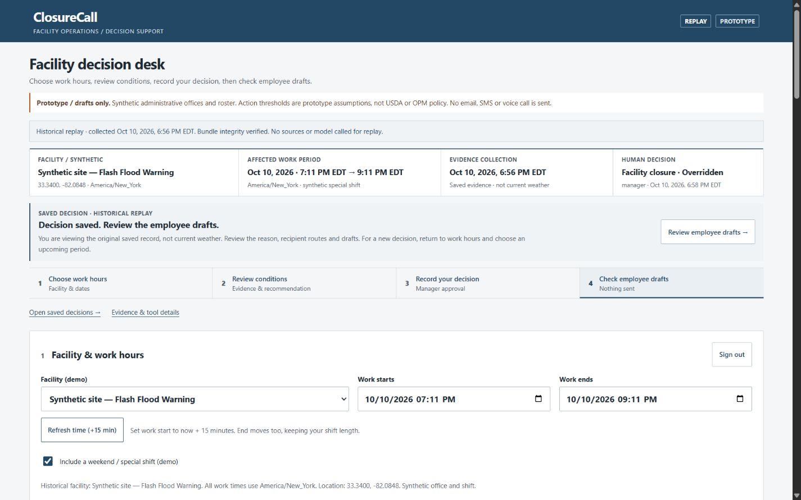

# ClosureCall

Evidence, a manager decision, and a record you can explain.

ClosureCall is an independent decision-support prototype for facility managers reviewing disruptive weather and operating conditions. It grew from the USDA Closure Call challenge, using AWS Strands Agents SDK and Akamai Cloud. Offices and staff are synthetic; action mappings are prototype assumptions; notifications remain drafts.



*Historical replay shown. Evidence and the manager's test override are preserved as recorded; this is not current weather.*

## Project status

ClosureCall has a complete prototype workflow and a verified decision-record boundary. It is ready for a technical portfolio review and a supervised demo with synthetic staff. Use with real employees would require operational policy review, identity controls, delivery integration and broader validation.

The October 13, 2026 review ran **93 tests** on Windows from an isolated source checkout without local environment/data, and the same **93 tests** against the existing Linux candidate image. These are offline regression checks; live integration, browser and restore evidence retain their original dates. [Product assessment and priorities](docs/PRODUCT_REVIEW.md), [verification](docs/VERIFICATION.md).

## Workflow

1. Choose a facility and affected work period in its timezone.
2. Collect NWS point alerts and modeled Open-Meteo/CAMS air quality.
3. Review applicability, source timing, missing inputs and the prototype recommendation.
4. Approve or record a reasoned manager override.
5. Inspect each recipient's route, channel and draft instructions.
6. Reopen the original decision without fetching sources or regenerating history.

The Strands agent reads five tools scoped to a frozen evaluation. Deterministic services control posture and recipient routing; the manager owns approval. The agent has no approval, sending, shell or cloud tool. [Architecture and module map](docs/ARCHITECTURE.md).

Engineering controls include strict request schemas, manager authentication, idempotent decisions, atomic decision/outbox writes, bounded worker execution, scoped evidence references and immutable historical records with integrity hashes. The model brief is optional; missing inference configuration is shown explicitly and does not replace missing source evidence.

## Run locally

Python 3.12 is the deployment target; Python 3.13 is also verified locally. For a fresh checkout:

```sh
python -m venv .venv
# Windows:
.venv\Scripts\python.exe -m pip install -r requirements-dev.txt
# macOS/Linux:
.venv/bin/python -m pip install -r requirements-dev.txt
```

Copy `.env.example` to `.env` only if no `.env` exists. Set manager credentials and an identifying `NWS_USER_AGENT` locally. An inference key is optional for the deterministic review path; without one, AI is explicitly unavailable/degraded. The example workshop endpoint's post-event availability is not newly verified. Secrets stay out of Git.

The remaining commands assume the virtual environment is active. Alternatively, invoke `.venv\Scripts\python.exe` on Windows or `.venv/bin/python` on macOS/Linux explicitly. The app runs independently of any coding-assistant session.

```sh
# Use the virtual environment's Python for both commands.
python scripts/seed_demo.py
python -m uvicorn app.main:app --host 127.0.0.1 --port 8000 --workers 1
```

Open `http://127.0.0.1:8000/`, sign in and select upcoming work hours. Weekend demo shifts require the explicit special-shift checkbox. **Refresh time (+15 min)** updates the form; **Check conditions & recommendation** starts an evaluation. Source failures differ from empty alert feeds, and no operating posture is a guarantee of safety.

For an existing workspace, preserve `.env`, databases and backups. See the [runbook](docs/RUNBOOK.md) for configuration, [demo script](docs/DEMO_SCRIPT.md) for a walkthrough and [limitations](docs/LIMITATIONS.md) for the actual boundaries.

## Development and verification

```sh
python -m pytest -q
npm ci --ignore-scripts
npm run format:check
python -m black --check --target-version py312 app tests scripts
```

Node.js is used only for a pinned formatter. There is no frontend framework, build step or runtime dependency on Node. The app is FastAPI/static HTML/CSS/JS/SQLite with one worker and one bounded Strands agent.

[Verification](docs/VERIFICATION.md) separates synthetic tests, recorded real integrations and dated runtime observations. [Contributing](CONTRIBUTING.md) describes the checks. The GitHub workflow is manual only; no hosted CI result is claimed. The source-export check used the existing dependency environment, so a fresh package installation is a separate check.

## Release and access

Private Linode source `a5681bc` was observed healthy on October 13, 2026. The portfolio application candidate `3bc1ddd` remains **undeployed**. This review changes tests and documentation; application code and dependencies are unchanged. Source, image and evidence scope are pinned in [RELEASE_MANIFEST.json](RELEASE_MANIFEST.json); a GitHub update is separate from deployment.

The repository remains private. Operator SSH access is not a public demo URL. A license, team credits, public access and new deployment remain owner decisions. [GitHub workflow](docs/GITHUB_PROGRESS.md) records the source/documentation distinction. [Review packet](SUBMISSION.md) and [LinkedIn draft](docs/LINKEDIN_DRAFT.md) are prepared copy; neither has been submitted or posted.

## Scope

This prototype supports evidence review and a decision record. It does not verify power, water, security, travel or local building safety; provide official USDA/OPM policy; integrate OnSolve; or deliver email/SMS/voice notifications. See [security boundaries](SECURITY.md), [sources](docs/SOURCES.md) and [attributions](docs/ATTRIBUTIONS.md).

Current documentation is indexed in [docs/README.md](docs/README.md). Dated hackathon reports are preserved in [the archive](docs/archive/hackathon/README.md), with original evidence and failed logs retained. A project license has not been selected.
