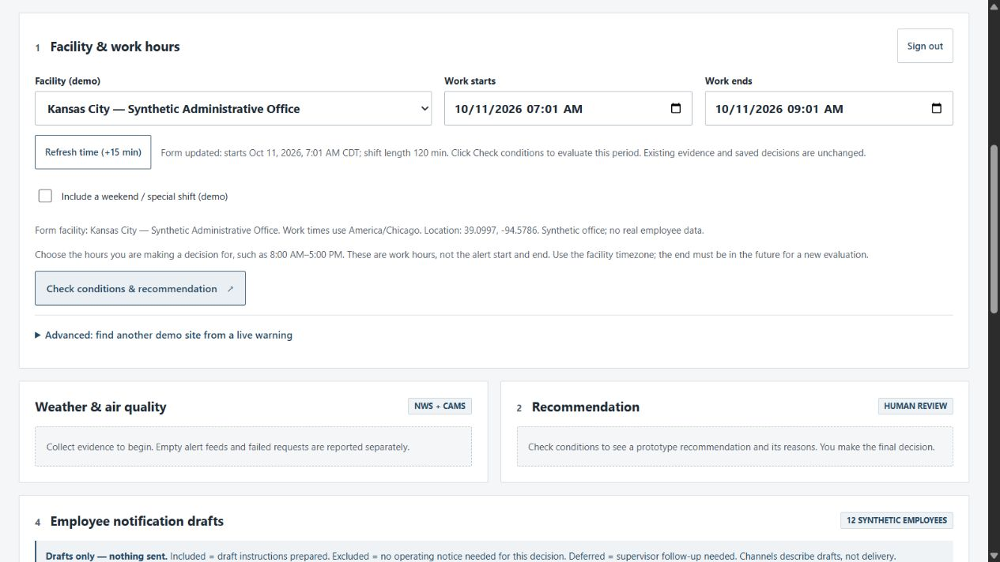

# Work-hours refresh — verified private release

Application source `a5681bcd98400fd75d02670f378a04365459dd7e`; image `sha256:9ab42b0dcdfaee241b3d9156ac5433ecd0da772f29707ec6cb397664f0256b90`. Healthy and authenticated at **http://127.0.0.1:8081/**, private SSH tunnel. Only the existing three static frontend files changed from 4e03e57; no backend, API, provider, policy, authority, persistence or dependency change.

**Refresh time (+15 min)** sets Work starts to device now +15 minutes using the selected facility timezone. End moves with it, preserving a positive valid elapsed period up to 24h. Empty/invalid/reversed/over-24h dates use a 2h default. Facility/special-shift selection is retained. Type=button/keyboard activation refreshes the form without submitting an evaluation; repeated clicks do not add another 15 minutes. Existing evidence, recommendation and saved replay stay unchanged. Confirmation clears when changing facility or reopening a saved record. The new control is disabled by the existing evaluate/save busy-button handling; pending workflow locking was inspected in code, not newly exercised with an evaluation in this checkpoint.

| Check | Actual evidence |
| --- | --- |
| Final full Windows suite | 89 passed in 14.18s, `evidence/work-hours-refresh/regression-windows.txt`; JS syntax check also passed. |
| Exact final Linux image | 89 passed in 6.38s, `regression-linux.txt`. Initial 1a8735f source passed 89/10.28s Windows and 89/6.51s Linux, retained as `*-initial-1a8735f.txt`; not promoted. |
| Final QA browser | Ten scoped cases VERIFIED: current Chicago time, midnight/custom duration, empty/reversed/>24h fallback, repeated click, keyboard, facility-change confirmation, New York frozen replay and reopening original dates. `browser-checks.json`. |
| Mobile | Actual 390px viewport/click, no horizontal overflow, `mobile-check.json`, `qa-mobile.jpg`. CSS unchanged between initial/final source; final change only resets the confirmation. Not accessibility certification. |
| No QA data writes | Actual 8084 DB: six table fingerprints exact, 10 runs / 9 decisions / 9 outbox unchanged; `qa-before.json`, `qa-after.json`. |
| Main browser/tunnel | Authenticated current source/footer, nine saved rows, refresh-only click in KC, start now+15 and 2h duration; `main-browser.json`, `main-desktop.jpg`. Three served files exact to Git bytes; `tunnel-static.json`. |
| Original data/cutover | Actual start 2026-10-11T11:45:50.513230916Z; fresh backup `/app/data/backups/closurecall-20261011T114549Z.sqlite3`. Six table fingerprints, all nine full replay bodies/bundle hashes exact; 2 facilities / 13 runs / 9 decisions/outbox. `production-before.json`, `production-pre-switch.json`, `production-after.json`, `data-integrity.json`, `deployment.txt`. |
| Runtime | `final-health.txt`: healthy, exact source/image. Loopback binding, appuser/read-only/cap-drop ALL retained. |

No new NWS/model invocation, original production evaluation/decision, public exposure, real notification sending or Submit in this checkpoint. Earlier real-source/model proof remains dated evidence in `evidence/precision-release`. Existing env, DB, original backups, immediate prior 4dffaac and earlier e5f7801 retained. Documentation/GitHub progress can advance independently of the frozen deployed source.

Use [demo script](DEMO_SCRIPT.md) and [private recovery](DEMO_RECOVERY.md). Refresh is based on the device clock; keep it correct. It does not refresh NWS/AQ or turn historical weather into current evidence.
