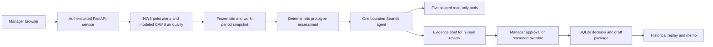

# Architecture

ClosureCall is one Python service with a static browser client and SQLite. The design keeps the decision boundary explicit: source connectors collect evidence, deterministic rules assess it, a bounded Strands agent reviews frozen information, and a manager records the operating decision.

The source connectors retain requested location, returned grid/point information, retrieval/validity times, source status and response hashes. Empty available NWS data differs from a failed request. Polygon contradictions, uncertain scope, expiry, work-period overlap and cancellation scope are assessed explicitly. Null-geometry coverage still relies on NWS point filtering; metadata that is consistently wrong may evade these checks.

The five tools are `read_facility_context`, `read_nws_evidence`, `read_air_quality_evidence`, `run_policy_assessment` and `preview_employee_impact`. They operate within the current snapshot/policy scope. The model selects validated references and review focus; factual text and the authoritative posture/routing come from deterministic services. Hooks bound model/tool calls, and a subprocess deadline terminates over-budget model work.

The manager decision freezes actor, reason, posture, effective period and any timing basis. A twelve-person synthetic roster covers onsite, essential, telework, offsite, no-shift and accessible-channel cases. Every route has a reason. Deferred review is manual. The outbox holds drafts; it has no email/SMS/voice transport.

Replay reads the original evidence, policy, roster, recommendation, AI trace, manager record and drafts. It does not fetch current conditions or recompute with current bindings. Hashes detect ordinary accidental changes; they do not provide a government compliance or privileged-host tampering guarantee. The memo renderer has a separate presentation version and does not rewrite the historical bundle.

| Source area | Responsibility |
| --- | --- |
| `app/main.py`, `auth.py`, `schemas.py` | HTTP contracts, manager principal and request validation |
| `app/clients/`, `policy/` | Source evidence and explicit prototype mappings |
| `app/agent/`, `jobs.py` | Read-only tools, grounded review and bounded worker lifecycle |
| `app/services/` | Evaluation, decision, recipient drafts and memo presentation |
| `app/db.py` | Persistence and frozen replay |
| `app/static/` | The existing HTML/CSS/JS workbench |
| `tests/` | Synthetic boundary, authorization, lifecycle and integrity checks |

Production runs a single worker on the existing private Linode deployment. Local previews use separate data and explicit fixture labels. No enterprise SSO, GIS database, monitoring scheduler, notification transport or additional agent architecture is implied.
