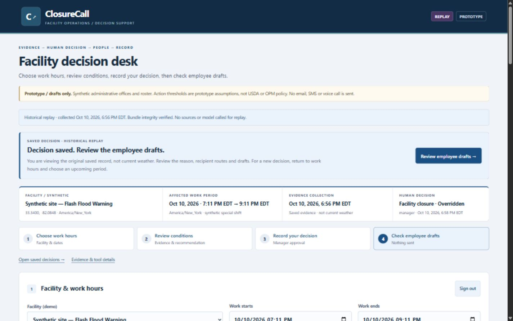
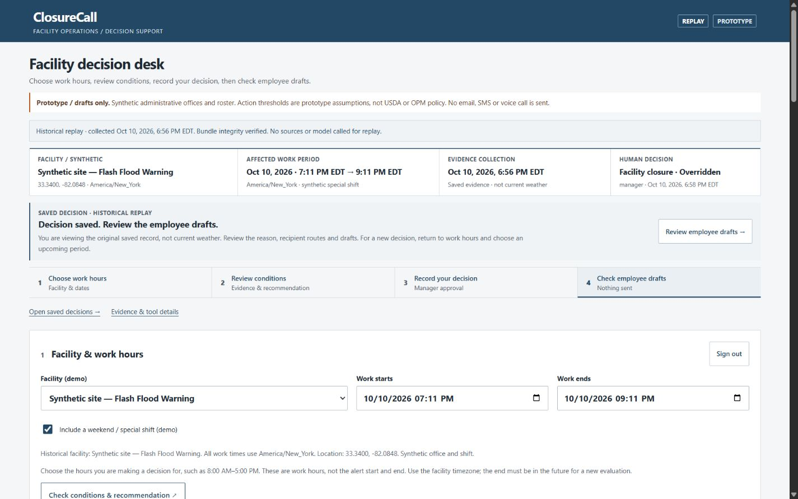
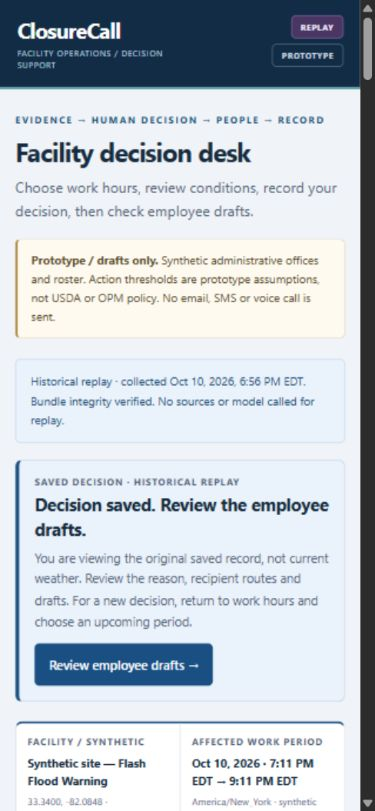
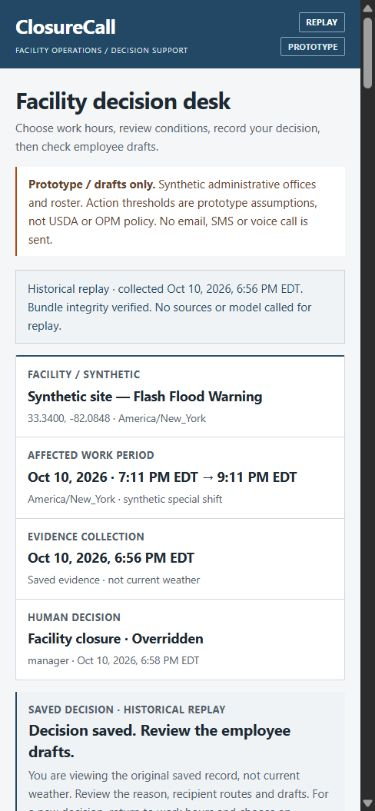
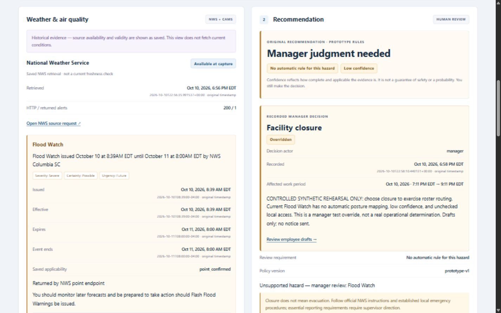
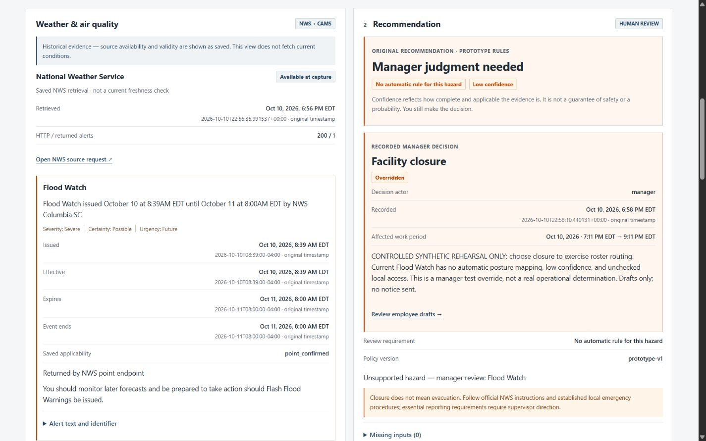

# ClosureCall precision design candidate

**Later release checkpoint, 2026-10-11 UTC:** user conditionally approved the design after the HTTP 8084 preview opened successfully, then requested private laptop-only presentation. Application source `4dffaac63f06b57bd97e2af17140ff850be147e5` is now verified deployed privately and open through 8081. Exact Linux suite 89/6.53s; separate remote real-source/model workflow and all nine original historical bodies verified unchanged. No new application edits after the design freeze. See [private release](PRIVATE_DESIGN_RELEASE.md), [main screenshot](../../../evidence/precision-release/main-desktop.jpg) and [evidence/manager screenshot](../../../evidence/precision-release/main-evidence.jpg). The dated design-pass limits below remain specific to that earlier pass; the later evidence supersedes only the browser, Linux/LIVE QA and private deployment gates. Public exposure was cancelled and no proxy started.

Local review candidate on `design/precision-console`, source freeze `2d6ef4ce3076c42b01573c2ed483bc296de84093`, based on `3e585f0`. This pass changes only `app/static/index.html` and `app/static/styles.css` in the application. No deployment, push, public exposure, cloud operation or production-data access was performed. Start: 2026-10-11 06:48:19 UTC; hard deadline: 07:23:19 UTC.

Final implementation/test evidence was recorded by 07:04:32 UTC, within the 35-minute design timebox. Delivery resumed after the user's later preview request at 11:01 UTC; no further application design or logic edits were made. Source SHA-256 values still match the final tested files in `invariants.json`.

## Five generic elements, ranked by operational impact

| Rank | Observed baseline | Why it matters |
| --- | --- | --- |
| 1 | Large introduction and next-step panel ahead of facility context | The manager has to scan past introductory material to identify the site and shift. |
| 2 | Approval form follows the entire evidence/recommendation grid | A long weather record pushes human authority away from its recommendation. |
| 3 | Repeated rounded, tinted panels with similar visual weight | Evidence, cautions, navigation and secondary records compete for attention. |
| 4 | Four navigation cards with circular step markers | Process guidance consumes space without adding decision evidence. |
| 5 | Three-column employee card grid and mixed color chips | Comparing recipients, channels and routing reasons requires jumping between boxes. |

## Exactly three focused changes

1. **Operational context and navigation.** Reduce the introductory footprint; place the existing facility/location/work-period/capture/decision context before the guide in DOM order; use a compact process strip. Keep the prototype, synthetic-roster and drafts-only disclosures. Native system typography remains in use.
2. **Evidence and human authority.** Keep weather/AQ beside the recommendation at desktop, and place the unchanged decision form immediately after the recommendation in the same column. Strengthen source captions, timestamp legibility, confidence disclosure and the human-action boundary. Evaluation, navigation and history use outline actions; saving a manager decision uses the filled navy action. Shorten the visible option to “Override recommendation” without changing its `override` value. Stack decision fields at intermediate and narrow widths.
3. **Recipient register and consistent semantics.** Replace twelve nested card surfaces with aligned recipient rows and dividers. Preserve every route, reason, channel, essential label, manual follow-up, message and export control. Use #F5F6F7 / #FFFFFF / #1F2933 / #234866, caution #B54708, readable green approval and red error states. Draft/replay use labeled navy states. No gradient, new framework, dependency, decorative animation or new business capability.

## Actual before/after comparison

Both comparisons show frozen decision `16a170c1-af9b-4950-86b2-a3eecf1ad26b`: the same synthetic facility, Flood Watch, source times, unsupported-hazard recommendation, low confidence, original reasoned override and twelve notification routes. This is historical evidence, not current LIVE weather. The facility's saved name still says “Flash Flood Warning”; the evidence itself says “Flood Watch”. Historical names were not rewritten.

| DOM measurement | Before | After |
| --- | ---: | ---: |
| Desktop control section starts | 763.17 px | 595.40 px |
| Desktop evidence/recommendation starts | 1199.18 px | 1011.20 px |
| Desktop outbox starts | 2608.07 px | 2331.40 px |
| Desktop document height, collapsed disclosures | 4798 px | 4696 px |
| Narrow document height, collapsed disclosures | 10534 px | 9225 px |

These are layout measurements, not task-completion, latency or impact claims. `before-layout.json`, `desktop-layout.json` and `narrow-layout.json` preserve the actual observations. Both requested browser viewports were verified as **1440×900** and **390×844**. The browser capture API exports JPEGs at **1425×891** and **375×811** respectively; both before/after pairs have identical encoded dimensions. No padding, cropping, recoloring or image editing was applied. `screenshot-dimensions.json` records that tooling distinction; direct screenshot capture returned the same narrow output size.

| View | Before | After |
| --- | --- | --- |
| Desktop overview |  |  |
| Narrow overview |  |  |
| Desktop evidence/recommendation |  |  |

Additional actual renders: [manager desktop](../../../evidence/precision/manager-desktop.jpg), [manager narrow](../../../evidence/precision/manager-narrow.jpg), [roster desktop](../../../evidence/precision/roster-desktop.jpg), [roster narrow](../../../evidence/precision/roster-narrow.jpg), [deferred draft and keyboard focus](../../../evidence/precision/deferred-narrow.jpg), [loading](../../../evidence/precision/loading-desktop.jpg), [validation error](../../../evidence/precision/error-desktop.jpg).

## Verification and limits

| Gate | Result | Evidence / exact scope |
| --- | --- | --- |
| Existing regression suite | VERIFIED | Final Windows run: **89 passed in 10.68s**, `evidence/precision/regression-windows.txt`. No tests were added or weakened. |
| Protected source and HTML contracts | VERIFIED | `verify_invariants.py` / `invariants.json`: 29 other application Git blobs unchanged from base; all 61 HTML IDs unique and preserved; control attributes, enum values, form ordering and script/style references unchanged. |
| Evaluation → review → approve → drafts → replay | VERIFIED, synthetic | Fresh ignored loopback QA database at 8086. Actual authenticated endpoints and existing decision service; source/model calls blocked. Double-click produced one evaluation and one approval decision. |
| Override and conditional time controls | VERIFIED, synthetic | Narrow browser: missing reason rejected; delayed-arrival override saved with reason, 08:30 timing and explicit synthetic assumption; one saved decision after double-click. |
| Validation/loading/recovery | VERIFIED | Reversed work hours and start beyond 24 hours returned visible errors. Eligible request showed disabled `aria-busy=true` button, collecting state, cleared previous content and hidden manager form. One bounded automation wait expired before the six-second fixture finished; fresh state confirmed completion. No provider-performance claim. |
| All recipient routes and channels | VERIFIED, displayed records | Twelve recipients present; accessible voice draft, essential personnel supervisor instructions, telework manual follow-up and offsite/no-shift exclusions remain readable. Native keyboard opens a draft disclosure; all notices remain drafts. |
| History refresh and browser reload | VERIFIED | Refresh retained saved rows. Reload required manager sign-in, then restored the saved replay and kept the approval form hidden. |
| Historical integrity | VERIFIED, QA copies | Original approved/override exports match their stored bodies and original bundle hashes exactly. Read-only verification opens only the newly created QA database. Harness blocks source/model calls; this is not a fresh production replay audit. |
| Responsive layout | VERIFIED, scoped | Replay/roster at widths 375, 390, 768, 1024 and 1440: no measured horizontal overflow; all twelve recipients remain. Manager form exercised at 1440 and 390. |
| Accessibility observations | VERIFIED, scoped | Native labeled inputs/disclosures, keyboard focus and existing live-region/error semantics retained. 36 rendered text samples had minimum computed contrast 5.00; zero console errors in the comparison tab. Not an accessibility certification or a full assistive-technology audit. |
| Variable route counts by changing hours alone | NOT VERIFIED | A midnight scenario still returned 9/2/1 because the built-in synthetic roster assigns onsite employees to each selected work period. That attempt is explicitly inconclusive in `browser-checks.json`; no roster/rule or snapshot changes were made to force a different count. |
| Fresh LIVE NWS/AQ, hosted model, exact Linux candidate | NOT VERIFIED in this pass | Existing historic tool/source proof was displayed as saved evidence. No new external-provider/model invocation or Linux/cloud test. |
| Production release/health | NOT VERIFIED afresh | Last recorded deployed commit **e5f7801829aaa1f7cfd326e02e415f8389fa3dde**, image **sha256:11bddbc767275d8af7d603511596cc432b5862fe07fd880d5404fac8d13f7184**, last remote read **2026-10-11T01:15:40Z**. This pass did not contact or modify Linode. |

The browser ledger contains 15 scoped observations: 14 verified and one inconclusive route-count scenario. Counts are not evidence for unexamined requirements.

## What still needs work or a separate release gate

The workbench remains information-dense. Full alert text, confidence basis, drafts and long history require scrolling/disclosures; the manager form is reached through its explicit step/link and is not guaranteed to fit beside the entire evidence record in one viewport. Secondary text remains compact. Native font/control rendering on Linux, zoom/assistive technology, print output, current LIVE freshness and production browser behavior have not been certified here. The saved facility name versus the actual hazard remains visible rather than rewriting audit data. No blocking browser defect was observed in the exercised design workflows.

Review the local candidate at `http://127.0.0.1:8084/`. Its footer retains the harness label `design-working-candidate`, not a verified deployed-commit label; static HTML/CSS are served directly from this branch. The separate 8086 QA server is disposable test infrastructure with synthetic source/model behavior, not the USDA demo deployment. Production/private-tunnel 8081 remains a separate last-known release, without a new connectivity claim.

On the later preview request, the old local preview process had stopped. Restarted the ignored loopback harness at 8084 using its existing QA database: 10 runs, 10 snapshots, 9 saved decisions and 9 outbox packages retained. Startup verified the two frozen historical exports exactly and continued blocking provider/model calls. No original/demo database was opened. Automated browser display was then rejected by its URL security policy; no alternate browser or bypass was attempted. The local link is provided for the user to open, but a fresh visible tab on the user's screen is NOT VERIFIED. The before/after images above are saved captures from the earlier verified candidate session, not fresh LIVE evidence.

Deployment remains outside this task. A later explicitly authorized release needs an exact Linux gate and a fresh current-data backup; candidate base includes the prior undeployed feedback changes. Judge access and Submit remain user-owned. No new permission or credential was required for this local design pass.

To reopen the same private QA preview from PowerShell in this checkout, run `.\.venv\Scripts\python.exe data\design_resume_preview.py`. The ignored launcher requires the existing QA location pointer/database; it does not provision resources or read production data. Keep the terminal running while reviewing.
